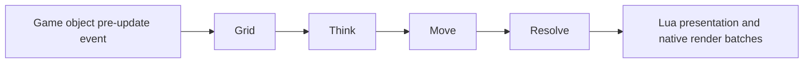

# Simulation queries and updates

The game creates one mutable query for rows tagged `moon.unit`. It spans both
teams and all four unit types. A query chooses rows; the registered update
functions choose the work and declare dependencies.

| Function | Work | Scheduling |
| --- | --- | --- |
| `Grid` | Snapshot rows; build the crowd grid and separate target lists for each team; count units near relays | One serial job |
| `Think` | Respawn, acquire targets, choose goals, advance weapon timers and decide directions | Disjoint ranges of 512 rows per job |
| `Move` | Integrate movement, neighbor separation, map bounds and obstacle avoidance | Disjoint ranges of 512 rows per job |
| `Resolve` | Collect attacks, apply damage and repairs, refresh the presentation snapshot, update relays and HQ health, decide victory | One serial job |

`Grid` depends on `DATASTORE_EVENT_GAMEOBJECT_PRE_UPDATE`. Each later function
depends on the preceding function's name. The engine waits for that chain before
game-object updates. Think and Move can split their own rows across workers;
they read other units through the snapshot and write only their assigned rows.
Resolve accumulates damage before applying it, preserving the same result with
zero or two workers.

Selection, formation orders and Hold reserve this same query with
`DataStoreQueryTryBegin`, iterate it, and release it with `DataStoreQueryEnd`.
They run outside the active scheduled chain. Rendering consumes the completed
snapshot rather than retaining DataStore row pointers.

The HUD's **Sim** number is live elapsed wall time from the start of Grid to the
end of Resolve, including scheduling gaps and synchronization. It excludes
presentation, graphics and physics. The larger **Frame delta** is the elapsed
interval between engine frames, including pacing and waits. Neither is a sum of
CPU time across worker threads.

## Culling

The sample projects living units onto the angled camera and skips unit model
instances outside screen bounds, with a small margin. This is CPU screen-space
culling before batching, rather than renderer-managed per-unit frustum bounds.
The terrain is drawn as one batch. The minimap and simulation still process all
living units, including those outside the camera. Distant units use the simpler
mesh from each glTF asset.
